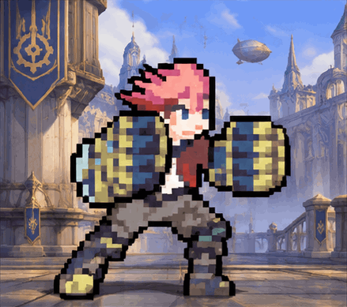
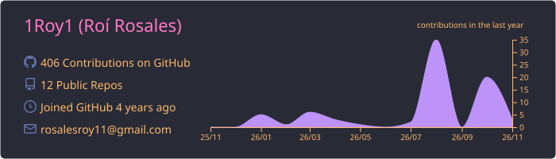
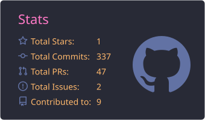
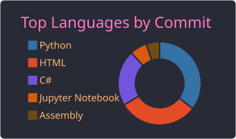

  

  

  
  
  
  

  
  

---

<table>
  <tr>
    <td width="58%" valign="top">

### 👑 Sobre mí

Soy **Roí Eleazar Rosales Arriola**, pero todos me dicen **Rey**. Soy **ingeniero en Informática y Sistemas** por la **Universidad Rafael Landívar**, y construyo software de punta a punta: desde la base de datos hasta la interfaz.

- 🧠 **Backend** con **Django**, **Node.js** y **C#**
- 🎨 **Frontend** con **React**, **TypeScript**, **JavaScript** y **HTML/CSS**
- 🐳 Contenedores y despliegues con **Docker**
- 🗄️ Bases de datos en **PostgreSQL** y **MySQL**
- 🤖 Desarrollo con **agentes de IA**: **Claude Code** y **Codex**
- 🛡️ Formación en ciberseguridad con **Cisco**

    </td>
    <td width="42%" align="center" valign="middle">
      
       
      <b>Main Vi</b> · <i>«Golpea primero, pregunta después.»</i> 🥊
    </td>
  </tr>
</table>

---

### 🛠️ Stack

  
   
  

| | Herramientas |
| :-- | :-- |
| ⚙️ **Backend** | Python · Django · Django REST Framework · Node.js · C# |
| 🖥️ **Frontend** | React · TypeScript · JavaScript · HTML · CSS · Vite |
| 🗄️ **Datos** | PostgreSQL · MySQL · SQLite |
| 🐳 **DevOps** | Docker · Docker Compose · GitHub Actions · CI/CD |
| ✅ **Calidad** | Pruebas automatizadas · Contratos OpenAPI · Accesibilidad · Revisión de código |
| 🤖 **IA** | Claude Code · Codex · desarrollo asistido por agentes |

---

### 🚀 En qué trabajo

- 🏥 **Plataforma clínica modular** para una clínica real: backend Django con API versionada y frontend React diseñado desde cero. Incluye agenda con control de conflictos y concurrencia, historia clínica, recetas en PDF, operaciones, permisos por rol y auditoría.
- 🧩 **Trabajo en equipo de verdad:** PRs apilados, contratos de API, pruebas en CI con PostgreSQL y revisión entre compañeros.
- 📚 **[Informatica_y_Sistemas-](https://github.com/1Roy1/Informatica_y_Sistemas-)**: mi recorrido por la carrera.

---

### 🏅 Insignias de Cisco

  
  &nbsp;&nbsp;&nbsp;
  

---

### 📊 Mi actividad en GitHub

  

  
  

  

  

Tarjetas y serpiente generadas cada día por GitHub Actions en este mismo repositorio.

---

### 🎧 Mientras programo

  
   
  <b>Depeche Mode · <i>Enjoy the Silence</i></b>
   
  Toca la imagen y empieza en la mejor parte 🎶 · <i>«All I ever wanted, all I ever needed is here in my arms…»</i>

  
  

---

### 🎮 Fuera del código

  🎮 Videojuegos (main Vi) &nbsp;·&nbsp; 💻 Programar &nbsp;·&nbsp; 🏋️ Ejercicio &nbsp;·&nbsp; 🎧 Música &nbsp;·&nbsp; 🤝 Ayudar a quien lo necesita &nbsp;·&nbsp; 😎 NASHE

---

### 📫 Contacto

  
  
  

  

